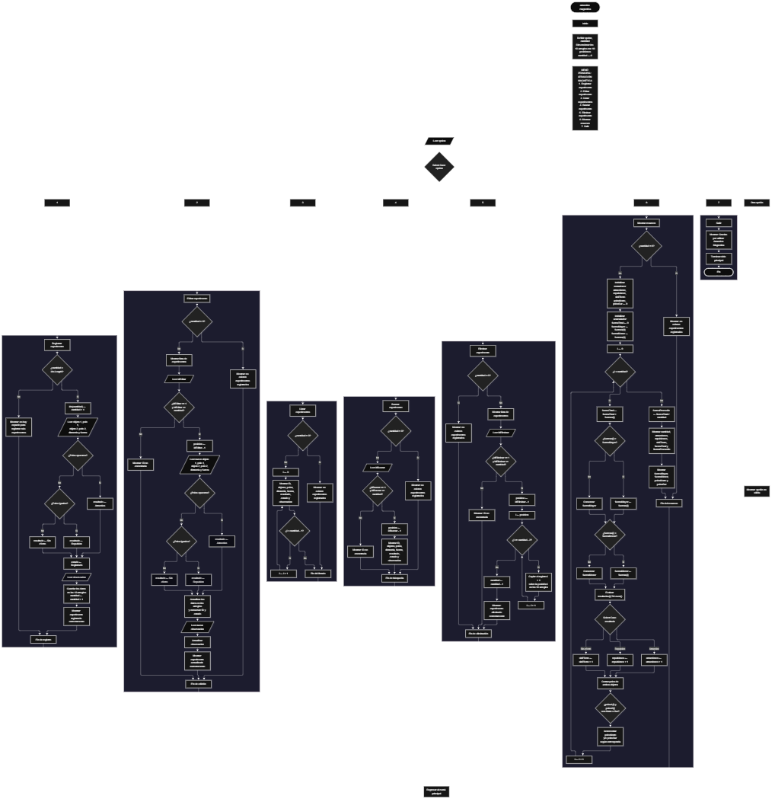

Este proyecto, llamado <b>atracción magnética</b>, fue desarrollado en <b>visual basic .net</b> como un ejercicio práctico para fortalecer la lógica de programación mediante la creación de un sistema de gestión de experimentos magnéticos desde la consola. El programa cuenta con un menú principal de siete opciones que permite <b>registrar, editar, eliminar, buscar y listar experimentos, además de consultar un resumen estadístico</b> de los registros almacenados. Cada experimento almacena información como los objetos participantes, sus polos magnéticos, la distancia, la fuerza, el resultado de la interacción, el estado y las observaciones, utilizando arreglos con una capacidad máxima de <b>10 experimentos durante la ejecución</b>. Durante su desarrollo se aplicaron conceptos fundamentales de programación, como variables, arreglos, estructuras condicionales, ciclos repetitivos y estructuras de selección, además de procesos para determinar la interacción entre polos magnéticos, reorganizar registros y calcular estadísticas. Este proyecto permite poner en práctica los conocimientos adquiridos en Visual Basic .NET y sirve como base para desarrollar sistemas de gestión más avanzados utilizando otros lenguajes y tecnologías.

<h2 align="center">⚙️ Funcionamiento del menú principal</h2>

### ➕ Registrar experimento

La opción <b>1) registrar experimento</b> permite almacenar un nuevo experimento magnético. Antes de realizar el registro, el sistema comprueba que la cantidad de experimentos almacenados sea menor que la capacidad máxima de los arreglos, utilizando la condición <b>cantidad &lt; ids.Length</b>. Si existe espacio disponible, asigna un identificador mediante la expresión <b>cantidad + 1</b> y solicita los datos correspondientes al <b>objeto 1, polo 1, objeto 2, polo 2, distancia y fuerza</b>. Después, utiliza estructuras condicionales <b>if, else if y else</b> para determinar automáticamente el resultado de la interacción magnética. Si los polos son opuestos, establece el resultado como <b>"Atraccion"</b>; si son iguales, establece <b>"Repulsion"</b>; y si los valores introducidos no corresponden a los polos reconocidos, asigna <b>"Sin efecto"</b>. Posteriormente, establece el estado del experimento como <b>"Registrado"</b>, solicita una observación, almacena los datos en sus respectivos arreglos e incrementa la variable <b>cantidad</b> en uno. Finalmente, muestra el mensaje <b>"Experimento registrado correctamente."</b>. Si los arreglos alcanzan su capacidad máxima, presenta el mensaje <b>"No hay espacio para registrar mas experimentos."</b> e impide agregar otro registro.

### ✏️ Editar experimento

La opción <b>2) editar experimento</b> permite modificar la información de un experimento registrado. Primero, el programa comprueba si existen experimentos almacenados mediante la variable <b>cantidad</b>. Si no hay registros, muestra el mensaje <b>"No existen experimentos registrados."</b>. En caso contrario, presenta una lista con los identificadores, objetos, polos, distancias, fuerzas, resultados, estados y observaciones de cada experimento. Después, solicita el identificador del experimento que se desea editar y comprueba que esté dentro del rango permitido mediante la condición <b>idEditar &gt;= 1 And idEditar &lt;= cantidad</b>. Si la selección es válida, calcula su posición utilizando <b>posicion = idEditar - 1</b> y solicita los nuevos datos del objeto 1, polo 1, objeto 2, polo 2, distancia y fuerza. A continuación, vuelve a evaluar los polos magnéticos mediante estructuras condicionales para actualizar automáticamente el resultado de la interacción. Finalmente, solicita una nueva observación, actualiza los datos correspondientes en los arreglos y muestra el mensaje <b>"Experimento actualizado correctamente."</b>. El identificador y el estado del experimento se mantienen sin modificaciones. Si el identificador introducido está fuera del rango permitido, presenta el mensaje <b>"ID no encontrada."</b>.

### 📋 Listar experimentos

La opción <b>3) listar experimentos</b> permite visualizar todos los experimentos registrados actualmente. Antes de mostrar la información, el programa comprueba si la variable <b>cantidad</b> es igual a cero. Si no existen registros, presenta el mensaje <b>"No existen experimentos registrados."</b>. Si hay experimentos disponibles, utiliza un ciclo <b>for</b> para recorrer los arreglos desde la primera posición hasta la última posición ocupada, comprendida entre <b>0</b> y <b>cantidad - 1</b>. Durante el recorrido, muestra el identificador, los dos objetos, sus respectivos polos, la distancia, la fuerza, el resultado magnético, el estado y las observaciones de cada experimento. Esta función facilita consultar todos los registros almacenados sin necesidad de buscar cada experimento individualmente.

### 🔎 Buscar experimento

La opción <b>4) buscar experimento</b> permite localizar un experimento mediante su identificador. Primero, el programa comprueba si existen experimentos registrados. Si no hay información almacenada, muestra el mensaje <b>"No existen experimentos registrados."</b>. En caso contrario, solicita el identificador del experimento que se desea buscar y verifica que esté dentro del rango permitido mediante la condición <b>idBuscar &gt;= 1 And idBuscar &lt;= cantidad</b>. Si el identificador es válido, calcula la posición correspondiente mediante <b>posicion = idBuscar - 1</b> y muestra toda la información del experimento: <b>objetos, polos, distancia, fuerza, resultado, estado y observación</b>. Si el identificador introducido no está dentro del rango permitido, presenta el mensaje <b>"ID no encontrada."</b>. La búsqueda utiliza el identificador como referencia para acceder a la posición correspondiente de los arreglos.

### 🗑️ Eliminar experimento

La opción <b>5) eliminar experimento</b> permite eliminar un experimento registrado mediante su identificador. Antes de comenzar, el programa comprueba que existan experimentos almacenados. Si no hay registros, muestra el mensaje <b>"No existen experimentos registrados."</b>. Si existen experimentos disponibles, presenta una lista con toda la información almacenada. Después, solicita el identificador del experimento que se desea eliminar y comprueba que esté dentro del rango permitido mediante la condición <b>idEliminar &gt;= 1 And idEliminar &lt;= cantidad</b>. Si el identificador es válido, calcula la posición utilizando <b>posicion = idEliminar - 1</b> y comienza el proceso de eliminación. Para mantener los registros organizados, utiliza un ciclo <b>for</b> controlado por la variable <b>i</b>, que desplaza una posición hacia atrás los datos de los experimentos posteriores en los diez arreglos: <b>ids, objetos1, polos1, objetos2, polos2, distancias, fuerzas, resultados, estados y observaciones</b>. Posteriormente, disminuye la variable <b>cantidad</b> en uno y muestra el mensaje <b>"Experimento eliminado correctamente."</b>. Si el identificador introducido está fuera del rango permitido, presenta el mensaje <b>"ID no encontrada."</b>. El programa reorganiza los registros, pero no renumera los identificadores que permanecen almacenados.

### 📊 Mostrar resumen

La opción <b>6) mostrar resumen</b> permite consultar estadísticas generales de los experimentos registrados. Primero, el programa comprueba si existen registros almacenados. Si la cantidad es igual a cero, muestra el mensaje <b>"No existen experimentos registrados."</b>. En caso contrario, inicializa diferentes contadores para clasificar los resultados magnéticos y los polos, además de acumuladores para calcular la fuerza total y las fuerzas máxima y mínima. Después, utiliza un ciclo <b>for</b> para recorrer los experimentos y acumular las fuerzas registradas, identificar la fuerza mayor y menor, contar las atracciones, repulsiones y experimentos sin efecto mediante una estructura <b>Select Case</b>, y contabilizar las apariciones de los polos norte y sur en ambos objetos mediante estructuras condicionales. Al finalizar el recorrido, calcula la fuerza promedio dividiendo la fuerza total entre la cantidad de experimentos. Finalmente, muestra el total de experimentos, las cantidades de cada resultado magnético, la fuerza total, la fuerza promedio, la mayor fuerza, la menor fuerza y el total de polos norte y sur registrados.

### 🚪 Salir del menú principal

La opción <b>7) salir</b> está destinada a finalizar la ejecución del programa y muestra el mensaje <b>"Gracias por utilizar Atraccion Magnetica."</b>. El menú principal se encuentra dentro de una estructura repetitiva <b>Do ... Loop While</b>, que mantiene el programa en funcionamiento mientras la variable <b>opcion</b> sea diferente de <b>7</b>. Cuando el usuario selecciona esta opción, el ciclo termina y finaliza la ejecución del programa. De esta manera, el usuario puede realizar diferentes operaciones de gestión de experimentos antes de salir del sistema.

<h2 align="center">🧠 Temas aplicados en el proyecto</h2>

### 📦 Variables

En este proyecto se utilizan variables para controlar las opciones del menú, almacenar la cantidad de experimentos registrados, identificar los registros que se desean editar, buscar o eliminar, recorrer los arreglos y realizar los cálculos estadísticos del resumen. También se utilizan variables auxiliares para almacenar identificadores, posiciones, contadores y acumuladores. Cada variable cumple una función específica dentro de las operaciones de gestión y análisis de experimentos magnéticos.

🔢 **Ids:** Arreglo que almacena los identificadores de los experimentos registrados.

📊 **Cantidad:** Almacena la cantidad actual de experimentos registrados.

⚙️ **Opcion:** Guarda la opción seleccionada por el usuario en el menú principal.

🔄 **I:** Funciona como contador en los ciclos `For` y permite recorrer los experimentos y reorganizar los registros durante la eliminación.

🔎 **IdEditar:** Almacena el identificador del experimento que se desea modificar.

🔍 **IdBuscar:** Almacena el identificador del experimento que se desea consultar.

🗑️ **IdEliminar:** Almacena el identificador del experimento que se desea eliminar.

📍 **Posicion:** Determina la posición del arreglo correspondiente al identificador seleccionado.

📈 **Atracciones, Repulsiones y SinEfecto:** Contabilizan los resultados de las interacciones magnéticas.

⚖️ **FuerzaTotal:** Acumula la suma de las fuerzas de todos los experimentos registrados.

🏆 **FuerzaMayor y FuerzaMenor:** Almacenan los valores máximo y mínimo de fuerza encontrados.

🧲 **PolosNorte y PolosSur:** Contabilizan las apariciones de los polos norte y sur en los dos objetos de cada experimento.

📊 **FuerzaPromedio:** Almacena el resultado de dividir la fuerza total entre la cantidad de experimentos.

### 🗃️ Arreglos

En este proyecto se utilizan diez arreglos paralelos relacionados con la información de cada experimento magnético. Cada arreglo tiene una capacidad de <b>10 posiciones</b> y utiliza el mismo índice para representar los datos correspondientes a un mismo experimento. Por ejemplo, los datos del experimento almacenado en la posición <b>0</b> se encuentran distribuidos entre <b>ids(0), objetos1(0), polos1(0), objetos2(0), polos2(0), distancias(0), fuerzas(0), resultados(0), estados(0) y observaciones(0)</b>. Esta organización permite registrar, recorrer, buscar, modificar, mostrar y eliminar experimentos de manera ordenada.

🆔 **Ids(10):** Almacena los identificadores de los experimentos.

🧲 **Objetos1(10):** Almacena los nombres o descripciones del primer objeto.

🧭 **Polos1(10):** Almacena el polo magnético del primer objeto.

🧲 **Objetos2(10):** Almacena los nombres o descripciones del segundo objeto.

🧭 **Polos2(10):** Almacena el polo magnético del segundo objeto.

📏 **Distancias(10):** Almacena las distancias entre los dos objetos.

💪 **Fuerzas(10):** Almacena los valores de las fuerzas magnéticas.

📊 **Resultados(10):** Almacena el resultado de la interacción magnética.

📌 **Estados(10):** Almacena el estado de cada experimento.

📝 **Observaciones(10):** Almacena las observaciones adicionales de cada experimento.

### 🔀 Estructuras condicionales

En este proyecto se utilizan las estructuras <b>If, ElseIf y Else</b> para determinar el resultado de la interacción entre los polos magnéticos de los dos objetos. Cuando se encuentran polos opuestos, el resultado se establece como atracción; cuando se encuentran polos iguales, se establece como repulsión; y cuando los valores introducidos no coinciden con los polos reconocidos, se asigna el resultado sin efecto. También se utilizan condiciones para comprobar si existen experimentos registrados, verificar la disponibilidad de espacio antes de agregar nuevos registros y validar los identificadores seleccionados para editar, buscar o eliminar experimentos. Estas estructuras permiten que el programa responda de manera diferente según los datos y las condiciones evaluadas.

### 🔄 Estructuras repetitivas

En este proyecto se utilizan las estructuras repetitivas <b>Do ... Loop While</b> y <b>For ... Next</b>. El ciclo <b>Do ... Loop While</b> mantiene activo el menú principal mientras el usuario no seleccione la opción 7. Por otro lado, los ciclos <b>For ... Next</b> permiten recorrer los arreglos para mostrar los experimentos registrados, presentar los datos antes de editar o eliminar, y realizar los cálculos estadísticos del resumen. También se utilizan durante la eliminación para desplazar los datos de los experimentos posteriores una posición hacia atrás, manteniendo organizados los registros activos.

### 🎯 Estructura según

El programa utiliza la estructura <b>Select Case</b> para evaluar el valor almacenado en la variable <b>opcion</b> y ejecutar el bloque de instrucciones correspondiente. Cada caso representa una operación específica del sistema: <b>registrar, editar, listar, buscar, eliminar, mostrar resumen o salir</b>. También se utiliza el bloque <b>Case Else</b> para mostrar el mensaje <b>"Opcion no valida."</b> cuando el usuario introduce un número que no coincide con ninguna de las opciones definidas en el menú. Además, dentro del resumen estadístico se utiliza otra estructura <b>Select Case</b> para clasificar los resultados de los experimentos en atracción, repulsión y sin efecto.

### 🔢 Dimensionamiento de arreglos

El programa utiliza la declaración de arreglos para establecer la capacidad de almacenamiento de los experimentos. Se definieron diez arreglos con índices desde <b>0 hasta 9</b>, lo que permite administrar un máximo de <b>10 experimentos durante la ejecución</b>. La cantidad de posiciones ocupadas se controla mediante la variable <b>cantidad</b>, mientras que la propiedad <b>ids.Length</b> permite comprobar la capacidad máxima disponible antes de registrar un nuevo experimento. De esta manera, las operaciones recorren únicamente los registros comprendidos entre la primera posición y la última posición ocupada.

### 🔄 Reorganización de registros

Cuando se selecciona un experimento para eliminarlo, el programa utiliza un ciclo <b>For</b> que comienza en la posición seleccionada y llega hasta <b>cantidad - 2</b>. En cada repetición, los datos de la posición siguiente se copian sobre la posición actual en los diez arreglos: <b>ids, objetos1, polos1, objetos2, polos2, distancias, fuerzas, resultados, estados y observaciones</b>. Después, la variable <b>cantidad</b> disminuye en uno para indicar que existe un experimento menos en los registros activos. De esta manera, los experimentos posteriores ocupan las posiciones disponibles sin dejar espacios vacíos entre los registros activos. Sin embargo, los identificadores originales no se renumeran después de la eliminación.

### 🧮 Contadores y acumuladores

El programa utiliza contadores y acumuladores para procesar la información de los experimentos durante la generación del resumen estadístico. Los contadores <b>atracciones, repulsiones y sinEfecto</b> registran la cantidad de experimentos clasificados según su resultado magnético. Los contadores <b>polosNorte y polosSur</b> contabilizan las apariciones de cada polo en ambos objetos. Por otro lado, el acumulador <b>fuerzaTotal</b> suma las fuerzas de todos los experimentos registrados. Estos valores permiten obtener estadísticas generales y conocer el comportamiento de los experimentos almacenados.

### 📈 Comparación de valores máximos y mínimos

Para identificar la mayor y menor fuerza magnética, el programa inicializa las variables <b>fuerzaMayor</b> y <b>fuerzaMenor</b> con el valor de la fuerza del primer experimento registrado. Después, utiliza un ciclo <b>For</b> para recorrer los demás experimentos y compara cada fuerza con los valores almacenados. Si encuentra una fuerza superior, actualiza <b>fuerzaMayor</b>; si encuentra una fuerza inferior, actualiza <b>fuerzaMenor</b>. Al finalizar el recorrido, ambas variables contienen los valores extremos encontrados entre los experimentos registrados.

### 🧲 Determinación de interacciones magnéticas

El programa aplica las reglas básicas de interacción entre polos magnéticos para determinar automáticamente el resultado de cada experimento. Utiliza el método <b>ToLower()</b> para convertir los valores introducidos a minúsculas antes de compararlos, permitiendo reconocer los polos aunque el usuario utilice diferentes combinaciones de mayúsculas y minúsculas. De esta manera, los polos opuestos producen atracción y los polos iguales producen repulsión. Cuando se introduce un valor diferente de <b>"norte"</b> o <b>"sur"</b>, el programa asigna el resultado <b>"Sin efecto"</b>.

<h2 align="center">¿Cómo se implementaron las operaciones crud en el proyecto?</h2>

Las operaciones <b>crud</b> se implementaron mediante las opciones del menú principal, permitiendo administrar los experimentos magnéticos registrados. La operación <b>crear</b> corresponde a <b>registrar experimento</b>, donde se introducen los datos de los dos objetos y sus características magnéticas; <b>leer</b> se realiza mediante las opciones <b>buscar experimento y listar experimentos</b>, que permiten consultar la información almacenada; <b>actualizar</b> corresponde a <b>editar experimento</b>, donde se modifican los datos de un experimento y se vuelve a calcular su resultado magnético; y <b>eliminar</b> se realiza mediante la opción <b>eliminar experimento</b>, que retira un registro y reorganiza los datos de los arreglos. Además, la opción <b>mostrar resumen</b> permite analizar estadísticamente la información almacenada. Todas estas operaciones utilizan variables, arreglos, condicionales y ciclos para gestionar los datos temporalmente durante la ejecución del programa.

<h2 align="center">Diagrama de flujo del proyecto</h2>

<h2 align="center">🛡️ Validaciones del programa</h2>

### 📭 No existen experimentos registrados

Esta validación se utiliza en las opciones de <b>editar, listar, buscar, eliminar y mostrar resumen</b>. El programa comprueba si la variable <b>cantidad</b> es igual a <b>0</b> y, si no existen experimentos registrados, muestra el mensaje <b>"No existen experimentos registrados."</b>. Esta comprobación evita continuar con las operaciones que necesitan información almacenada cuando no hay registros disponibles.

### ⚠️ Capacidad máxima de experimentos

Esta validación se utiliza durante el registro de nuevos experimentos para controlar la capacidad máxima de los arreglos. El programa comprueba si <b>cantidad &gt;= ids.Length</b> antes de permitir agregar un nuevo registro. Si existe espacio disponible, solicita los datos del experimento y aumenta el contador. En caso contrario, muestra el mensaje <b>"No hay espacio para registrar mas experimentos."</b>, impidiendo agregar registros cuando se han ocupado las diez posiciones disponibles.

### 🔢 Identificador de experimento

Esta validación se utiliza durante las operaciones de <b>editar, buscar y eliminar</b>. El programa comprueba que el identificador introducido sea mayor o igual a <b>1</b> y menor o igual a <b>cantidad</b>. Si el valor se encuentra dentro de ese rango, calcula la posición correspondiente mediante la expresión <b>id - 1</b> para acceder a los arreglos. Si el identificador está fuera del rango permitido, muestra el mensaje <b>"ID no encontrada."</b>. Esta comprobación valida el rango numérico, aunque el programa supone que los identificadores coinciden con las posiciones de los arreglos más uno.

### 🧲 Clasificación de polos magnéticos

Durante el registro y la edición de experimentos, el programa utiliza estructuras condicionales para reconocer los polos <b>"norte"</b> y <b>"sur"</b>. Mediante el método <b>ToLower()</b>, convierte los valores introducidos a minúsculas para realizar las comparaciones sin distinguir entre mayúsculas y minúsculas. Si los polos son opuestos, establece el resultado como <b>"Atraccion"</b>; si son iguales, establece <b>"Repulsion"</b>; y si los valores no corresponden a ninguna combinación reconocida, asigna <b>"Sin efecto"</b>. Sin embargo, no solicita nuevamente los datos cuando se introduce un polo incorrecto.

### 📊 Control de cálculos estadísticos

Antes de calcular el resumen, el programa comprueba que exista al menos un experimento registrado. Si hay información disponible, inicializa los contadores y acumuladores para evitar utilizar valores anteriores en los cálculos. También inicializa las variables <b>fuerzaMayor</b> y <b>fuerzaMenor</b> con la fuerza del primer experimento registrado. Finalmente, calcula la fuerza promedio dividiendo la fuerza total entre la cantidad de experimentos, evitando realizar una división entre cero porque la operación solo se ejecuta cuando existen registros.

### ⚠️ Identificadores después de eliminar

Cuando se elimina un experimento, el programa desplaza los datos de los registros posteriores una posición hacia atrás y disminuye la variable <b>cantidad</b>. Sin embargo, no actualiza los identificadores de los experimentos restantes. Como las operaciones de edición, búsqueda y eliminación calculan la posición mediante <b>ID - 1</b>, después de eliminar un experimento intermedio puede producirse una correspondencia incorrecta entre el identificador y la posición real del registro. Además, al registrar un nuevo experimento, el programa asigna el identificador mediante <b>cantidad + 1</b>, lo que puede generar identificadores duplicados.

### ❌ Opción inválida

La estructura <b>Select Case</b> incluye el bloque <b>Case Else</b>, que muestra el mensaje <b>"Opcion no valida."</b> cuando el usuario introduce un número que no corresponde a ninguna de las opciones definidas en el menú principal. Esta comprobación permite informar al usuario cuando selecciona una operación no disponible y mantiene el programa en funcionamiento para que pueda realizar otra selección.

<h2 align="center">🎯 Objetivo del proyecto</h2>

El objetivo principal de este proyecto es fortalecer la <b>lógica de programación</b> mediante el desarrollo de un sistema de gestión de experimentos magnéticos en <b>visual basic .net</b>. A través de su construcción se busca aplicar los conocimientos adquiridos sobre variables, arreglos, estructuras condicionales, ciclos repetitivos y estructuras de selección, integrándolos para resolver un problema de manera organizada. Además, el proyecto permite comprender cómo registrar, consultar, modificar y eliminar información, determinar automáticamente las interacciones entre polos magnéticos y generar resúmenes estadísticos mediante contadores, acumuladores y comparaciones de valores. De esta manera, se establece una base para desarrollar sistemas de gestión y análisis más completos con otros lenguajes y tecnologías.

